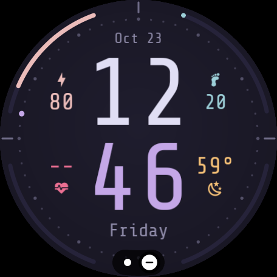

# Rosé Pine watch face

A [Rosé Pine](https://rosepinetheme.com) digital watch face for Wear OS, built with the
[Watch Face Format](https://developer.android.com/training/wearables/wff). No code, no
companion app: just resources. Needs Wear OS 5 or later (Watch Face Format v2, for weather).

<p align="center"></p>

- Stacked hours over minutes in Shure Tech Mono, hours in `text`, minutes in `iris`
- Four bezel gauges, each matching the metric beside it:
  battery (`rose`), steps toward 10k (`foam`), heart rate 40 to 180 bpm (`love`),
  chance of rain (`gold`)
- Weather icon for the current condition, with night variants for clear and partly cloudy
- Minute track with a stepping seconds dot
- Always-on mode drops the background, gauges and icons to black and dims the rest

## Build

Needs the Android SDK (build-tools 34, platform 34) and [uv](https://docs.astral.sh/uv/).

```sh
./build.sh                         # build/rosepine-watchface.apk, signed with the debug key
./build.sh 192.168.1.50:5555       # build and install over adb
```

Set it as the active face from the watch's face picker, or over adb:

```sh
adb shell am broadcast -a com.google.android.wearable.app.DEBUG_SURFACE \
    --es operation set-watchface --es watchFaceId us.lastra.rosepine.watchface
```

## Layout

`res/raw/watchface.xml` is generated. Edit `extras/gen_face.py` instead; `build.sh` runs it
on every build. The generator holds the palette, the gauge geometry and the vertical
layout (`TIME_Y` moves everything at once). It also reads the bundled font and shifts each
Nerd Font icon so its outline, not its cell, is centered, since the runtime centers by
advance width.

`extras/prep_fonts.py` subsets the fonts in `res/font` to ASCII, the degree sign and the
icons the face uses. It also builds the other font sets that were tried during design.
`extras/wallpaper.py` renders a matching phone wallpaper.

## License

Code is MIT. The bundled font subsets are Shure Tech Mono Nerd Font, derived from Share
Tech Mono by Carrois Type Design, under the SIL Open Font License (`LICENSE-fonts.txt`).
Icons come from Material Design Icons via Nerd Fonts.
